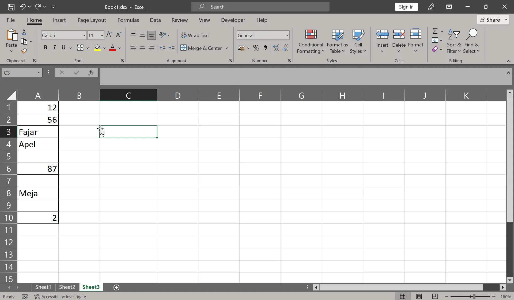
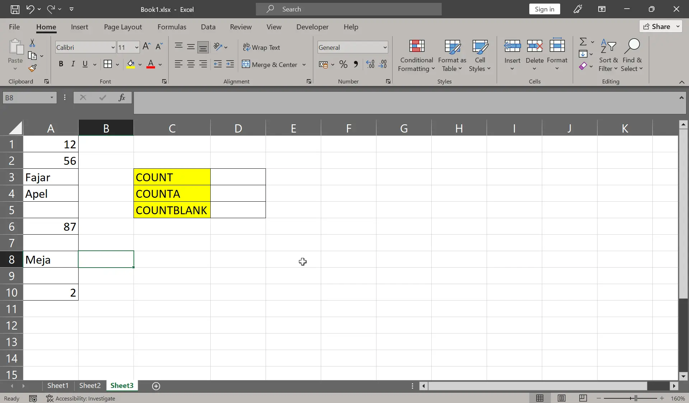
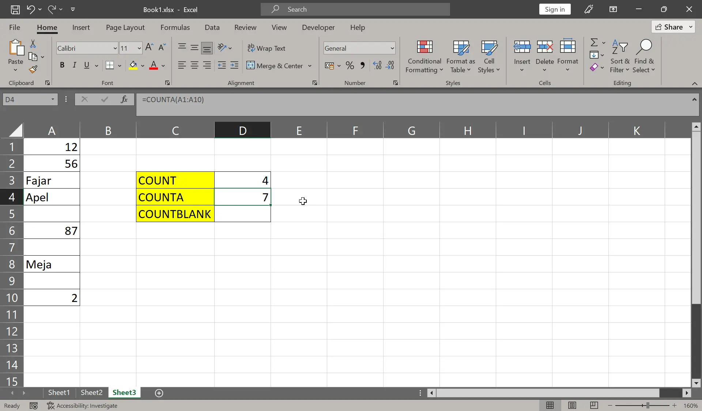
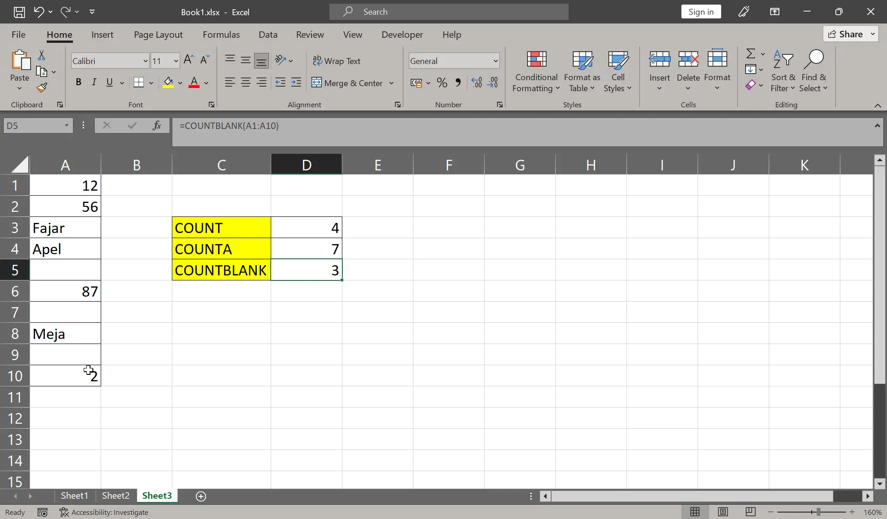

#+title: Menghitung Banyak Data di Excel Menggunakan Fungsi COUNT, COUNTA, dan COUNTBLANK
#+date: 2026-10-29
#+hugo_base_dir: ../../../../
#+hugo_section: tutorials/excel
#+hugo_bundle: count-counta-countblank
#+export_file_name: index
# #+hugo_weight: 3
#+hugo_series: "Rumus Excel"
#+hugo_custom_front_matter: :series_order 3

* Pembuka

Pada artikel ini kita akan menggunakan fungsi untuk menghitung berapa banyak sel yang terisi data atau sel yang kosong di Excel.

Menghitung berapa banyak sel di sini bukan menjumlahkan nilai dalam sel. Kadang saya tertukar makna dari dua kata tersebut.

* Konsep Dasar: Jenis Isi Sel

Pada pembahasan ini kita akan membagi jenis isi sel di Excel menjadi tiga yaitu angka, teks, dan kosong yang berarti ketiadaan nilai. Mereka diperlakukan berbeda, sehingga cara menghitungnya pun berbeda.

Supaya lebih jelas perbedaan tiga jenis isi sel tadi, mari kita buat contoh tabel sederhana. Kamu boleh mulai mengisi data dari sel *A1*.

#+caption: Tabel awal

Pada tabel di atas =12=, =56=, =87=, dan =2= adalah angka. Kemudian =Fajar=, =Apel=, dan =Meja= adalah teks. Lalu ada sel yang kosong pada tabel tersebut.

* Langkah-Langkah Menggunakan Fungsi

Pada bab ini kita akan menggunakan tiga fungsi yaitu:

| Fungsi     | Kegunaan                                     |
|------------+----------------------------------------------|
| COUNT      | Menghitung sel yang berisi angka saja        |
| COUNTA     | Menghitung sel yang terisi atau tidak kosong |
| COUNTBLANK | Menghitung sel yang kosong                   |

** Fungsi COUNT

Buka kembali tabel sebelumnya. Kita akan menggunakan rumus =COUNT= untuk menghitung banyak sel yang terisi dengan angka.

Tambahkan tabel kecil di samping tabel data utama untuk mengisi rumusnya seperti contoh berikut:

#+caption: Tabel sebelum rumus

*Instruksi*:
1. Pada sel =D3=, ketiklah ==COUNT(=
2. Blok dari sel =A1= sampai sel =A10=
3. Kemudian tutup kurung, lalu *Enter*

Hasilnya sebagai berikut:

#+caption: Hasil fungsi count

Sekarang pada sel =D3= hasilnya adalah =4=, karena pada tabel di atas ada empat sel yang isinya angka yaitu 12, 56, 87, dan 2. Di formula bar rumusnya: ==COUNT(A1:A10)=.

** Fungsi COUNTA

Selanjutnya kita akan menggunakan rumus =COUNTA= untuk menghitung banyak sel yang ada isinya.

*Instruksi*: Pada sel =D4=, ketiklah ==COUNTA(= . Blok range yang sebelumnya =A1:A10=. Kemudian tutup kurung dan *Enter*.

Pada formula bar, rumus akhirnya adalah ==COUNTA(A1:A10)=. Dan hasilnya sebagai berikut:

#+caption: Hasil fungsi counta

Pada sel =D4= hasilnya adalah =7=, karena tabel di atas ada tujuh sel yang terisi dengan angka atau teks yaitu 12, 56, Fajar, Apel, 87, Meja, dan 2.

** Fungsi COUNTBLANK

Terakhir kita akan menggunakan rumus =COUNTBLANK= untuk menghitung sel yang kosong atau tidak ada nilainya sama sekali.

*Instruksi*: Pada sel =D5=, ketiklah ==COUNTBLANK(= . Blok lagi range =A1:A10=. Kemudian tutup kurung dan *Enter*.

Jadi rumus akhirnya adalah ==COUNTBLANK(A1:A10)=. Dan hasilnya adalah sebagai berikut:

#+caption: Hasil fungsi countblank

Pada sel =D5= hasilnya adalah 3, karena ada tiga sel pada tabel tadi yang kosong yaitu pada baris 5, 7, dan 9.

* Kesalahan Umum

** Hasil =COUNTA= Tidak Sesuai dengan yang Kita Lihat

=COUNTA= tidak hanya menghitung angka dan teks. Tapi juga pesan error dan spasi. Pesan error yang ditampilkan itu bisa berupa =#N/A=, =#DIV/0!= dan lain-lain.

Jadi kita perlu memeriksa tiap sel untuk menghapus spasi yang seharusnya tidak ada, dan pesan error yang tidak diinginkan agar hasilnya sesuai.

Tapi saya sarankan untuk tidak terburu-buru menghapusnya karena mungkin saja hasil yang diminta memang seperti itu.

Bila tabel itu ada di file pribadi kita, maka kita sendiri bisa memutuskan hasilnya mau seperti apa. Namun bila file itu milik kantor, sebaiknya kita cari tahu dulu hasil yang diminta seperti apa. Kalau bisa tanyakan juga pada mereka yang lebih tahu proses kerjanya.
