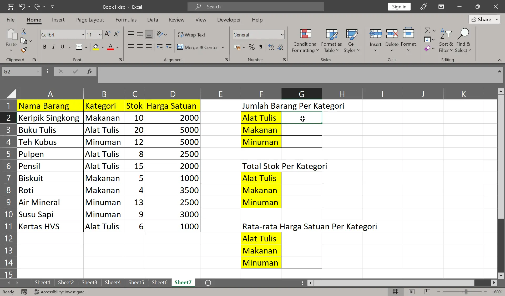
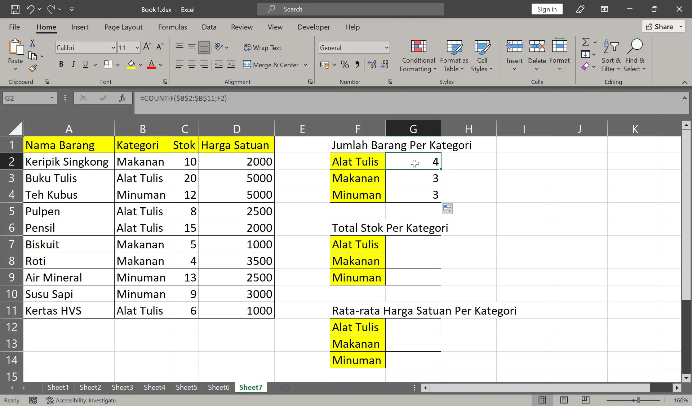
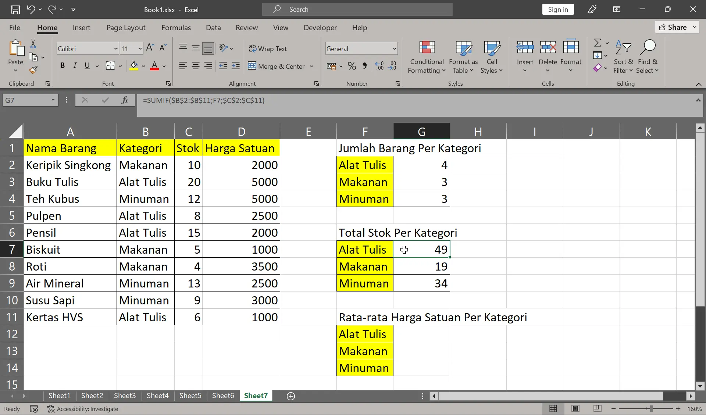
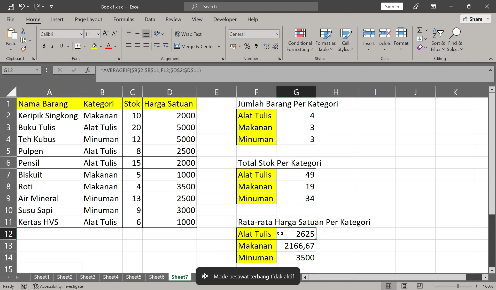

#+title: Melakukan Perhitungan Bersyarat di Excel Menggunakan Fungsi COUNTIF, SUMIF, dan AVERAGEIF
#+date: 2026-11-20
#+description: Perhitungan bersyarat di Excel dengan COUNTIF, SUMIF, dan AVERAGEIF.
#+hugo_base_dir: ../../../../
#+hugo_section: tutorials/excel
#+hugo_bundle: countif-sumif-averageif
#+export_file_name: index
# #+hugo_weight: 6
#+hugo_series: "Rumus Excel"
#+hugo_custom_front_matter: :series_order 6

* Pembuka

Pada artikel ini kita akan menggunakan fungsi ~COUNTIF~, ~SUMIF~, dan ~AVERAGEIF~ untuk melakukan perhitungan bersyarat.

Apa itu perhitungan bersyarat? Coba bayangin dulu. Kita punya tabel barang-barang, dan hanya barang dari kategori tertentu saja yang mau kita hitung. Kalau pakai rumus ~SUM~, itu pasti akan menotal semua barang termasuk barang yang kita tidak mau total, jadi solusinya pakai ~SUMIF~.

Contoh lainnya lagi, kita mau hitung ada berapa banyak barang dari kategori tertentu saja, pakai ~COUNTIF~. Kalau mau rata-rata barang tertentu, ya pakai ~AVERAGEIF~.

Kita akan coba ketiga fungsi itu satu per satu. Sekarang kita buat tabel barangnya dulu.

* Menyiapkan tabel barang

Tabel yang akan kita buat adalah tabel barang dagangan toko.

*Instruksi*: Buatlah tabel barang ini mulai dari sel A1

#+caption: Tabel barang dagangan toko
| Nama Barang      | Kategori   | Stok | Harga Satuan |
|------------------+------------+------+--------------|
| Keripik Singkong | Makanan    |   10 |         2000 |
| Buku Tulis       | Alat Tulis |   20 |         5000 |
| Teh Kubus        | Minuman    |   12 |         5000 |
| Pulpen           | Alat Tulis |    8 |         2500 |
| Pensil           | Alat Tulis |   15 |         2000 |
| Biskuit          | Makanan    |    5 |         1000 |
| Roti             | Makanan    |    4 |         3500 |
| Air Mineral      | Minuman    |   13 |         2500 |
| Susu Sapi        | Minuman    |    9 |         3000 |
| Kertas HVS       | Alat Tulis |    6 |         1000 |

Setelah tabel utama selesai dibuat, tambahkan tabel ringkasan: *Jumlah Barang Per Kategori*, *Total Stok Per Kategori*, dan *Rata-rata Harga Satuan Per Kategori* di samping tabel utama.

Berikut tampilan tabel awal sebelum diisi rumus:

#+caption: Tabel awal tanpa rumus

* Menggunakan Fungsi COUNTIF Untuk Menghitung Jumlah Barang Per Kategori

Pada tabel sebelumnya kita punya tiga kategori yaitu, =Makanan=, =Minuman=, dan =Alat Tulis=. Sekarang kita ingin menghitung untuk masing-masing kategori ada berapa barang menggunakan fungsi ~COUNTIF~.

Fungsi ~COUNTIF~ punya notasi rumus sebagai berikut:

#+begin_example
=COUNTIF(range;kriteria)
#+end_example

Penjelasan:
1. *range*: rentang sel yang berisi data yang akan diperiksa berdasarkan kriteria. Karena di sini kita mau cari tahu jumlah barang per kategori, maka yang jadi range-nya adalah seluruh isi kolom kategori.
2. *kriteria*: apa yang mau kita hitung. Nanti bisa kita isi langsung dengan teksnya misal ~"Makanan"~, atau kita klik sel referensinya.

Langkah-langkahnya sebagai berikut:
1. Di sel ~G2~ ketiklah: ~=COUNTIF(~.
2. Kemudian blok seluruh isi kolom kategori, jadinya: ~=COUNTIF(B2:B11~
3. Kunci range itu dengan referensi absolut dengan menekan *F4* lalu ketik tanda titik koma (~;~), jadinya: ~=COUNTIF($B$2:$B$11;~.
4. Klik =Alat Tulis= di sel ~F2~ lalu tutup kurung. Jadinya: ~=COUNTIF($B$2:$B$11;F2)~. Kemudian tekan *Enter*.
5. Sekarang di sel ~G2~ hasilnya adalah =4=. Tarik fill handle untuk mengisi baris berikutnya.

Hasil akhirnya adalah sebagai berikut:

#+caption: Tabel "Jumlah Barang per Kategori" yang sudah terisi semua

Sebenarnya argumen =kriteria= rumus di atas bisa juga ditulis langsung seperti ini: ~=COUNTIF($B$2:$B$11;"Alat Tulis")~. Tapi saya menggunakan referensi sel, alasannya agar bila fill handle-nya ditarik ke bawah, alamat sel-nya akan otomatis menyesuaikan dengan sel di sampingnya. Kalau ditulis langsung ~"Alat Tulis"~ , maka kriteria pada baris di bawahnya masih tetap ~"Alat Tulis"~, jadi harus diganti lagi argumen kriteria satu per satu.

* Menggunakan Fungsi SUMIF Untuk Menghitung Total Stok per Kategori

Selanjutnya kita akan menggunakan fungsi ~SUMIF~ untuk menghitung total stok masing-masing kategori barang.

Fungsi ~SUMIF~ punya notasi rumus sebagai berikut:

#+begin_example
=SUMIF(range;kriteria;sum_range)
#+end_example

Penjelasan:
1. range: merupakan rentang sel yang isinya akan diperiksa berdasarkan argumen kriteria.\\
   misalnya di sini karena kita mau mencari total stok dari kategori =Alat Tulis=, maka seluruh isi kolom =Kategori= harus diblok.
   
2. kriteria: merupakan syarat yang menentukan baris mana yang mau kita hitung.\\
   misalnya yang mau dicari adalah total stok kategori =Alat Tulis=, maka isi dengan ~"Alat Tulis"~ di sini.

3. sum_range: rentang sel yang mau dijumlah.\\
   jadi karena di sini kita mau mencari total stok pada setiap kategori, maka seluruh isi kolom =Stok= harus kita blok.

Untuk langkah-langkahnya sebagai berikut:
1. Pada sel ~G7~, ketiklah rumus ~=SUMIF(~.
2. Kemudian blok seluruh isi kolom kategori dan tekan *F4* lalu titik koma. Jadinya: ~=SUMIF($B$2:$B$11;~.
3. Klik =Alat Tulis= pada sel ~F7~ dan titik koma. Jadinya: ~=SUMIF($B$2:$B$11;F7;~.
4. Lanjut blok seluruh isi kolom =Stok=, lalu tekan *F4* dan tutup kurung. Jadinya: ~=SUMIF($B$2:$B$11;F7;$C$2:$C$11)~.
5. Hasil total stok untuk =Alat Tulis= adalah =49=. Kemudian tarik fill handle untuk mengisi rumus di baris berikutnya.

Hasil akhirnya adalah sebagai berikut:

#+caption: Tabel "Total Stok per Kategori" yang sudah terisi semua

Argumen =kriteria= bisa langsung ditulis, namun di sini saya menggunakan sel referensi, alasannya mirip seperti fungsi ~COUNTIF~ tadi.

* Menggunakan Fungsi AVERAGEIF Untuk Mencari Rata-rata Harga Satuan per Kategori

Terakhir kita akan mencari rata-rata harga satuan per kategori menggunakan fungsi ~AVERAGEIF~.

Notasi fungsi ~AVERAGEIF~ adalah sebagai berikut:

#+begin_example
=AVERAGEIF(range;kriteria;average_range)
#+end_example

Notasinya mirip dengan ~SUMIF~ tadi ya:

1. range: rentang sel yang mau diperiksa berdasarkan kriteria
2. kriteria: syarat yang menentukan baris mana yang akan dihitung
3. average_range: rentang sel yang akan dicari rata-ratanya.

Karena notasi dan cara menggunakan fungsi ini mirip dengan fungsi ~SUMIF~, saya tidak akan jelaskan langkah-langkahnya panjang-panjang. Kamu bahkan boleh coba mengerjakannya secara mandiri dulu.

Petunjuk:
1. Ketik rumusnya di sel ~G12~
2. range-nya adalah kolom =Kategori=
3. average_range-nya adalah kolom =Harga Satuan=

Sehingga rumus akhirnya adalah ~=AVERAGEIF($B$2:$B$11;F12;$D$2:$D$11)~ dan hasilnya yaitu =2625=.

Berikut tampilan tabel rata-rata harga satuan per kategori yang sudah terisi semuanya:

#+caption: Tabel "Rata-rata Harga Satuan per Kategori" yang sudah terisi semua

* Kesalahan Umum

** Salah Menentukan Rentang Sel: "range"

Ketiga fungsi di atas bekerja dengan memeriksa rentang sel. Jika rentang yang kita blok salah, maka hasilnya bisa tidak sesuai.

Misalnya pada rumus ~COUNTIF~, range yang kita blok adalah kolom =Kategori= karena kita mau cari kategori =Alat Tulis= ada berapa. Tapi kalau yang kita blok malah kolom =Nama Barang=, maka hasilnya adalah =0=, karena di kolom =Nama Barang= tidak ada sel yang bernilai =Alat Tulis=.

Hal yang sama juga akan terjadi pada rumus ~SUMIF~, yang mau kita hitung adalah =Alat Tulis=, tapi yang kita blok malah kolom =Nama Barang=, maka hasilnya juga akan 0.

** Salah Menentukan Rentang Sel yang Akan Dihitung: "sum_range" dan "average_range"

Fungsi ~SUMIF~ dan ~AVERAGEIF~ punya argumen ketiga yaitu ~sum_range~ dan ~average_range~ yang diisi dengan rentang sel yang dihitung.

Misalnya saat mau menghitung total stok =Alat Tulis=, yang kita blok di argumen ~sum_range~-nya malah kolom =Nama Barang=, maka hasilnya adalah =0=. Bisa juga yang kita blok malah kolom =Harga Satuan=, maka hasilnya =10500=, tentunya ini bukan hasil yang kita inginkan ya.

Yang perlu kita perhatikan dari kesalahan ini ~sum_range~ serta kesalahan sebelumnya ~range~ adalah mereka tidak menampilkan peringatan apa-apa bila terjadi kesalahan.

Mereka cuma mengembalikan nilai =0= atau hasil perhitungan yang tidak tepat seperti =10500= bila salah memilih ~range~. Pada tabel kecil ini kita masih bisa menyadari kesalahan tersebut, namun kalau tabelnya besar mungkin akan sulit menyadarinya.

Tapi untungnya pada fungsi ~AVERAGEIF~, kesalahan memilih ~range~ dan ~average_range~ akan menghasilkan nilai =#DIV/0!= bila yang mau dicari rata-ratanya tidak ketemu atau menghasilkan nilai yang tidak sesuai juga.

** Tidak Menggunakan Tanda Kutip Dua Saat Mengetik Langsung "kriteria"

Kita sudah pernah membahas ini di artikel sebelumnya ya, semua teks yang diketik langsung dalam rumus harus diapit oleh kutip dua.

Cobalah tulis argumen kriteria langsung tanpa kutip dua seperti ini: ~=SUMIF($B$2:$B$11;Alat Tulis;$C$2:$C$11)~. Di Excel saya hasilnya adalah =0=, bagaimana di Excel kamu? Mungkin saja hasilnya =#NAME?= karena itu kejadian yang lebih umum, terus kenapa Excel saya begini ya? 😁

** Lupa Mengunci "range", "sum_range", atau "average_range" Saat Menarik Fill Handle

Rentang sel pada ketiga argumen itu perlu dikunci bila ingin ditarik pakai fill handle. Alasannya karena tiap ditarik satu baris ke bawah, rentang sel itu juga ikut bergeser satu baris ke bawah. Jadi sel yang seharusnya diblok malah tidak terblok.

** Masalah Spasi Lagi

Sepertinya kita pernah membahas ini sebelumnya, tapi saya sebut lagi di sini karena masalah ini cukup sering terjadi.

Spasi di Excel dianggap sebagai karakter, jadi ="Alat Tulis"= tidak sama dengan ="Alat Tulis "= . Bila kita menulis ="Alat Tulis"= di rumus tanpa spasi, maka data ="Alat Tulis "= yang ada spasi di belakangnya pada tabel tidak ikut terhitung. Hasilnya bisa berkurang yang harusnya =4= malah jadi =3=.

* Referensi

1. [[https://support.microsoft.com/id-id/excel/get-started/use-the-countif-function-in-microsoft-excel][Menggunakan fungsi COUNTIF di Microsoft Excel]]. Diakses pada 19 November 2026.
2. [[https://support.microsoft.com/id-id/excel/functions/sumif-function][Fungsi SUMIF]]. Diakses pada 19 November 2026.
3. [[https://support.microsoft.com/id-id/excel/functions/averageif-function][Fungsi AVERAGEIF]]. Diakses pada 19 November 2026.
