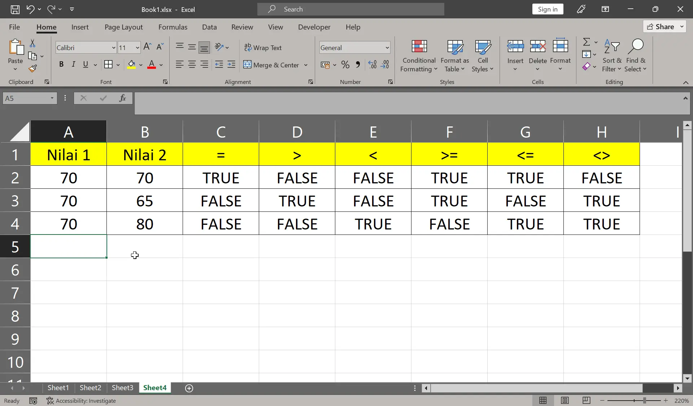
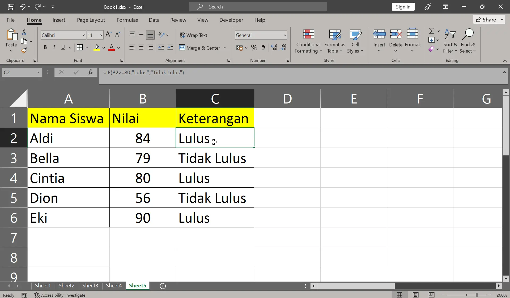
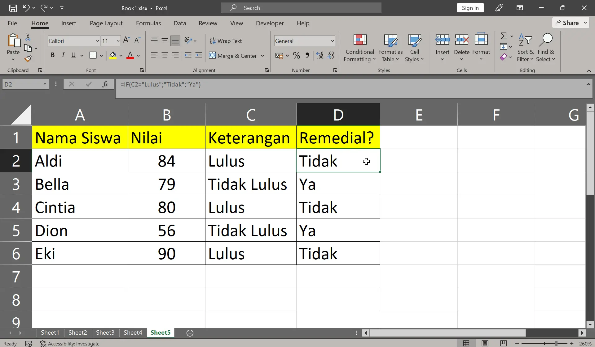

#+title: Menggunakan Fungsi IF Tunggal untuk Uji Logika di Excel
#+date: 2026-11-12
#+hugo_base_dir: ../../../../
#+hugo_section: tutorials/excel
#+hugo_bundle: single-if
#+export_file_name: index
# #+hugo_weight: 4
#+hugo_series: "Rumus Excel"
#+hugo_custom_front_matter: :series_order 4

* Pembuka

Pada artikel ini kita akan menggunakan fungsi =IF= tunggal. Dengan fungsi =IF= kita bisa membuat Excel mengambil keputusan dari data yang ada berdasarkan kondisi tertentu. Contoh penggunaannya adalah menentukan keterangan lulus atau tidak lulusnya siswa dari tabel nilai yang tersedia berdasarkan batas nilai yang sudah diputuskan.

* Konsep Dasar

** Melakukan Uji Logika dengan Operator Perbandingan

Uji logika adalah proses memeriksa suatu kondisi terpenuhi atau tidak. Hasil pemeriksaannya hanya boleh ada dua yaitu *TRUE* bila kondisinya terpenuhi, dan *FALSE* bila kondisinya tidak terpenuhi.

Dalam uji logika ada beberapa operator perbandingan yang umum digunakan:

#+caption: Tabel operator perbandingan
| Operator | Keterangan              |
|----------+-------------------------|
| =        | Sama dengan             |
| >        | Lebih dari              |
| <        | Kurang dari             |
| >=       | Lebih dari sama dengan  |
| <=       | Kurang dari sama dengan |
| <>       | Tidak sama dengan       |

Untuk lebih jelasnya coba lihat tabel di bawah ini:

#+caption: Tabel kebenaran

Pada tabel di atas kita ingin membandingkan dua angka menggunakan enam operator perbandingan. Yang bernilai =TRUE= adalah kondisi yang benar dan =FALSE= adalah yang salah.

Kita ambil contoh =70= dan =65=:

#+caption: Contoh proses uji logika
| Operator | Apakah ... ? | Hasil        | TRUE/FALSE |
|----------+--------------+--------------+------------|
| =        | 70 = 65      | tidak, salah | FALSE      |
| >        | 70 > 65      | iya, benar   | TRUE       |
| <        | 70 < 65      | tidak, salah | FALSE      |
| >=       | 70 >= 65     | iya, benar   | TRUE       |
| <=       | 70 <= 65     | tidak, salah | FALSE      |
| <>       | 70 <> 65     | iya, benar   | TRUE       |

** Notasi Fungsi IF

Setelah kita memahami konsep uji logika di Excel, sekarang kita masuk pada notasi fungsi =IF=. Fungsi =IF= punya tiga argumen yang ditulis dalam notasi seperti berikut:

#+begin_example
=IF(kondisi_uji; nilai_jika_benar; nilai_jika_salah)
#+end_example

Keterangan:

#+caption: Penjelasan tiga argumen fungsi if
| Argumen          | Keterangan                                         |
|------------------+----------------------------------------------------|
| kondisi_uji      | Kondisi yang ingin diperiksa oleh Excel            |
| nilai_jika_benar | Hasil yang ditampilkan jika kondisi bernilai TRUE  |
| nilai_jika_salah | Hasil yang ditampilkan jika kondisi bernilai FALSE |

Agar lebih jelas mari kita terapkan pada contoh sederhana. Pada tabel sebelumnya ditampilkan hasil uji logika dari berbagai operator perbandingan. Sekarang kita coba ambil simbol operator ~>~ untuk membandingkan tiga angka yaitu =70=, =65=, dan =80=.

*Instruksi*: Cobalah ketik dua rumus ini pada sel yang berbeda kemudian lihat hasilnya apa.

#+begin_quote
=IF(70>65;"Lebih Besar";"Tidak Lebih Besar")

=IF(70>80;"Lebih Besar";"Tidak Lebih Besar")
#+end_quote

Rumus di atas akan menghasilkan salah satu dari dua nilai yaitu =Lebih Besar= atau =Tidak Lebih Besar=. Bila hasilnya tidak keluar, coba periksa apakah susunan rumusnya sudah sesuai? Apakah tanda baca seperti titik koma ~;~ dan tanda kutipnya ~"~ sudah lengkap dan letaknya sudah sesuai? Bila semua itu terpenuhi /Insya Allah/ hasilnya akan keluar.

Pada rumus pertama kondisi yang ingin diuji adalah apakah 70 lebih besar dari 65? Jika ternyata 70 itu memang benar lebih besar dari 65 maka hasilnya adalah =Lebih Besar=, namun kalau salah maka hasilnya adalah =Tidak Lebih Besar=. Kita tahu bahwa memang benar 70 itu lebih besar dari 65, maka di Excel hasil yang seharusnya adalah =Lebih Besar=.

Rumus kedua kondisinya berubah sekarang kita ingin menguji apakah 70 lebih besar dari 80? Kita sudah tahu ya, kalau 70 tidak lebih besar dari 80, maka di Excel hasilnya adalah =Tidak Lebih Besar=.

Dari dua contoh di atas kita sudah tahu cara kerja fungsi =IF=, bila kondisi uji pada argumen pertama terpenuhi, maka nilai jika benar pada argumen kedua akan ditampilkan, namun bila kondisi uji tidak terpenuhi maka nilai jika salah pada argumen ketiga yang ditampilkan.

#+begin_quote
[!IMPORTANT] Koma (,) atau Titik Koma (;)

Rumus di atas menggunakan titik koma sebagai pemisah antara argumen. Namun ada juga yang menggunakan koma sebagai tanda pemisah.

Cek sub-bab [[*Menggunakan Pemisah Argumen yang Tidak Sesuai]]
#+end_quote

* Menggunakan Fungsi IF

** IF Dengan Syarat Angka

Setelah kita paham konsep uji logika dan notasi fungsi =IF=, mari kita terapkan itu pada kasus sederhana.

*Kasus*: Seorang guru ingin memberikan keterangan lulus atau tidak lulus untuk siswa-siswa yang ada di tabel berikut. Guru menyatakan bahwa yang lulus adalah siswa yang memiliki nilai 80 ke atas sedangkan yang di bawahnya dinyatakan tidak lulus.

*Instruksi*: Buatlah tabel berikut di sheet baru pada Excel. Kamu boleh mulai dari sel *A1*.

#+caption: Tabel nilai siswa
| Nama Siswa | Nilai | Keterangan |
|------------+-------+------------|
| Aldi       |    84 |            |
| Bella      |    79 |            |
| Cintia     |    80 |            |
| Dion       |    56 |            |
| Eki        |    90 |            |

Berdasarkan kasus di atas kita bisa membuat notasi fungsi ~IF~-nya seperti ini:

#+begin_example
=IF(nilai_siswa>=80;"Lulus";"Tidak Lulus")
#+end_example

Sekarang kita masukkan notasi rumusnya di Excel.

1. Pada sel keterangan =Aldi= yaitu *C2*, ketiklah ~=IF(~.
2. Kemudian klik nilai =Aldi= yaitu =84=, rumusnya sekarang menjadi ~=IF(B2~.
3. Lanjutkan rumusnya menjadi ~=IF(B2>=80;"Lulus";"Tidak Lulus")~. Kemudian *Enter*.
4. Sekarang muncul hasilnya untuk =Aldi= adalah =Lulus=.
5. Tarik Fill Handle untuk mengisi keterangan siswa yang lainnya.

Hasil akhir tabelnya sebagai berikut:

#+caption: Tabel nilai siswa yang sudah diisi rumus

** IF Dengan Syarat Teks

Selain membandingkan angka, fungsi =IF= juga bisa digunakan untuk mencocokkan teks.

*Kasus*: Guru tadi ingin menambahkan keterangan remedial pada siswa yang tidak lulus sementara yang lulus tidak remedial.

*Instruksi*: Tambahkan kolom =Remedial?= di samping kolom =Keterangan= pada tabel sebelumnya.

#+caption: Tabel awal keterangan remedial
| Nama Siswa | Nilai | Keterangan  | Remedial? |
|------------+-------+-------------+-----------|
| Aldi       |    84 | Lulus       |           |
| Bella      |    79 | Tidak Lulus |           |
| Cintia     |    80 | Lulus       |           |
| Dion       |    56 | Tidak Lulus |           |
| Eki        |    90 | Lulus       |           |

Berdasarkan kasus di atas kita bisa membuat notasi rumusnya jadi seperti ini:

#+begin_example
=IF(keterangan="Lulus";"Tidak";"Ya")
#+end_example

Sekarang kita masukkan notasi rumus tersebut ke Excel:

1. Pada sel =Remedial?= =Aldi= yaitu *D2*, ketiklah ~=IF(~.
2. Kemudian klik =Keterangan= =Aldi= yaitu =Lulus=, sehingga rumusnya menjadi ~=IF(C2~.
3. Lanjutkan rumusnya menjadi ~=IF(C2="Lulus";"Tidak";"Ya")~, lalu *Enter*.
4. Sekarang muncul hasil untuk =Aldi= yaitu =Tidak=.
5. Tarik Fill Handle untuk mengisi baris di bawahnya.

Hasil akhir tabelnya akan menjadi seperti ini:

#+caption: Hasil keterangan remedial siswa

* Kesalahan Umum

** Lupa Menggunakan Tanda Kutip Pada Teks

Setiap teks yang ditulis langsung sebagai argumen fungsi =IF= wajib diapit tanda kutip dua (=" "=). Baik yang dijadikan sebagai pembanding atau teks yang ingin ditampilkan sebagai hasil.

Contoh yang tepat pada rumus sebelumnya:

#+begin_example
=IF(B2>=80;"Lulus";"Tidak Lulus")
#+end_example

Kata =Lulus= dan =Tidak Lulus= wajib diapit tanda kutip dua, salah satu dari dua kata itu akan ditampilkan berdasarkan kondisinya =TRUE= atau =FALSE=. Sementara angka =80= tidak menggunakan kutip.

Contoh yang kurang tepat:

#+begin_example
=IF(B2>=80;Lulus;Tidak Lulus)
#+end_example

Hasil rumus di atas adalah =#NAME?=.

** Salah Menggunakan Operator Perbandingan

Pada contoh di atas guru menginginkan siswa yang nilainya dari 80 ke atas dinyatakan lulus. Makanya kita pakai operator pembanding ~>=~ bukan ~>~.

Ada sedikit perbedaan dari kedua operator tersebut yaitu bila menggunakan ~>=~ maka hitungannya =80= akan disertakan, tapi kalau memakai ~>~ =80= tidak disertakan. Bila kita pakai ~>~ maka siswa yang nilainya =80= pas akan dinyatakan tidak lulus.

** Salah Menentukan Sel Referensi

Pada latihan sebelumnya kita diminta untuk langsung klik sel referensinya agar tidak salah ketik. Dengan klik langsung kita jadi tahu sel mana yang saat ini sedang ditunjuk.

Bila mau diketik biasa boleh, tapi diperiksa juga apakah alamat sel yang diketik itu sudah menunjukkan ke sel yang tepat.

** Menggunakan Pemisah Argumen yang Tidak Sesuai

Masalah pemisah argumen antara koma dan titik koma sebelumnya sudah dibahas. Kedua tanda itu bergantung pada pengaturan pemisah daftar di sistem operasi, yang kemudian diikuti oleh Excel.

Cara paling mudah untuk mengetahui pemisah argumen yang digunakan yaitu dengan melihat bantuan rumus saat kita mengetik rumus di Excel. Itu biasanya muncul di dekat sel yang sedang kita ketik rumusnya. Di sana tampil pemisah argumennya. Bila yang tampil adalah koma, ganti semua titik koma yang digunakan pada rumus di artikel ini dengan koma.

** Ada Spasi Yang Tidak Terlihat

Spasi walau tidak kita lihat tapi itu juga dianggap sebagai karakter. Misalnya di sel yang sedang diperiksa tertulis ~"Lulus "~ tapi di rumusnya kita menulis ~"Lulus"~. Excel menganggap mereka berbeda jadi hasil yang ditampilkan adalah nilai jika salahnya yang dalam rumus remedial tadi adalah =Ya=.
