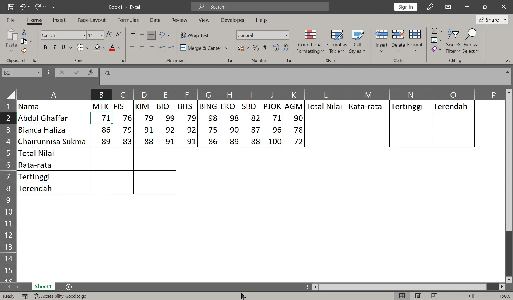
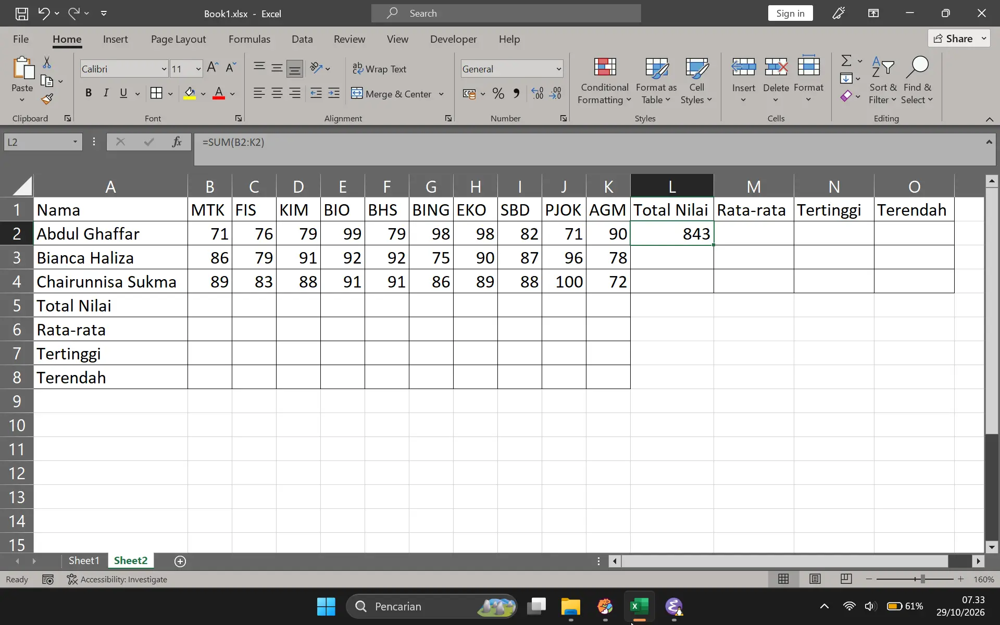
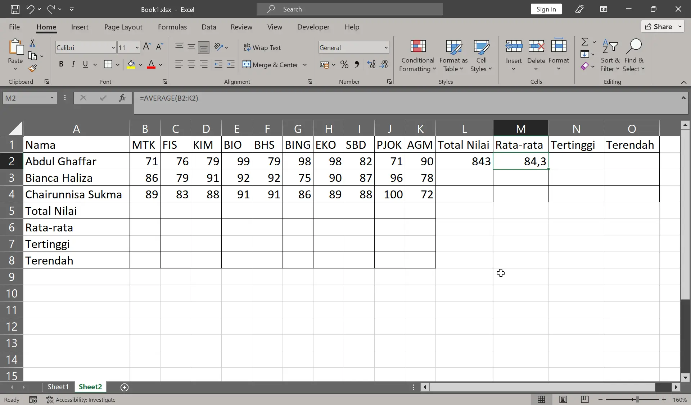
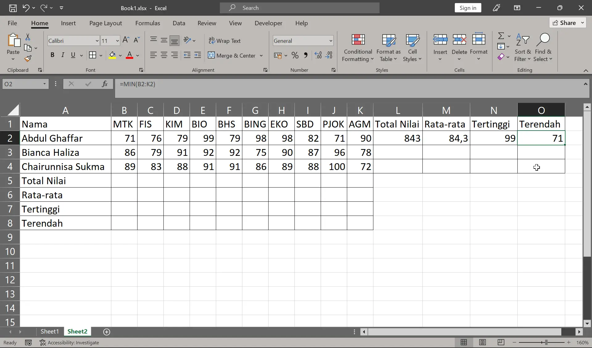
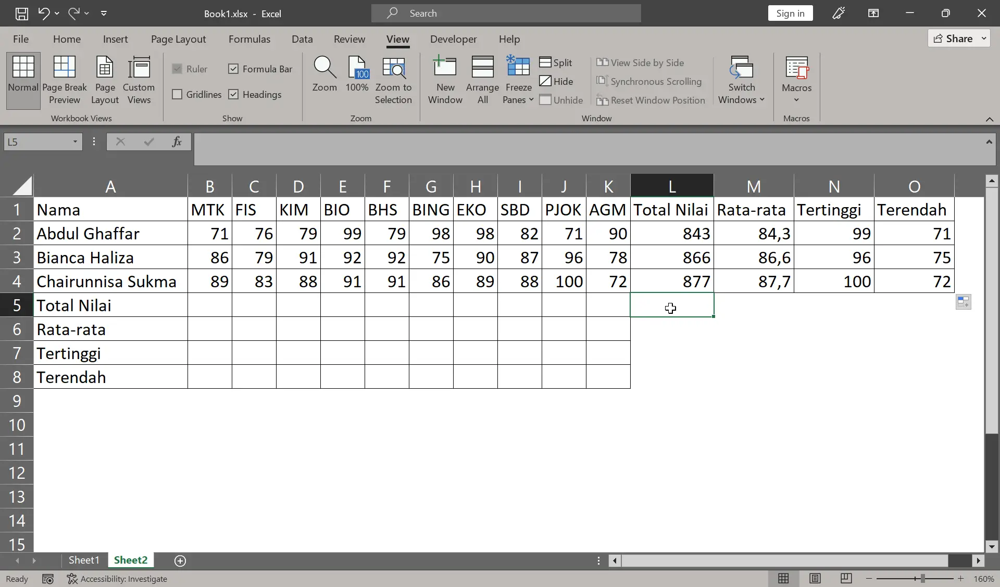
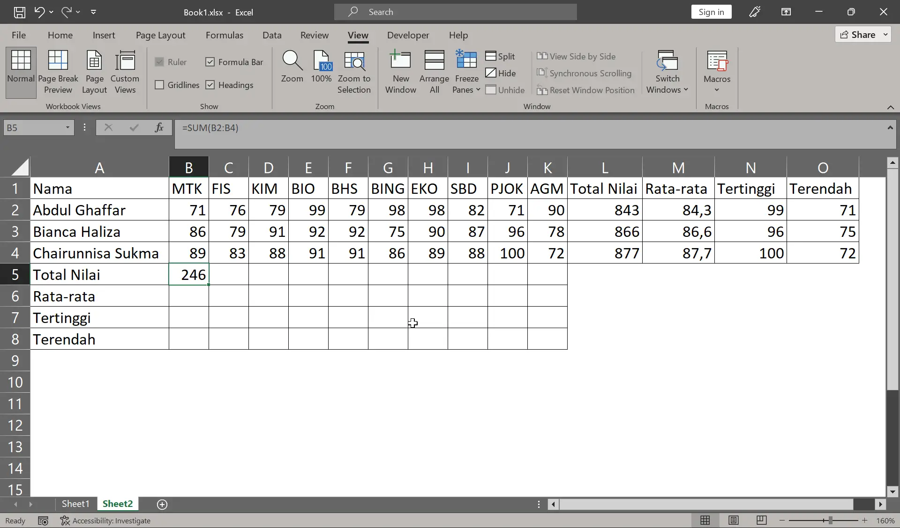
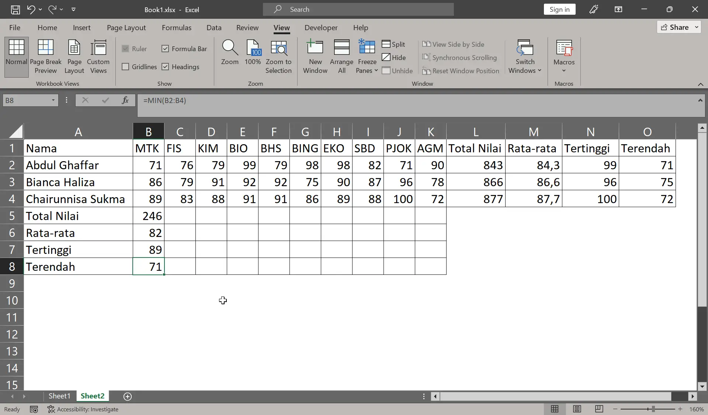
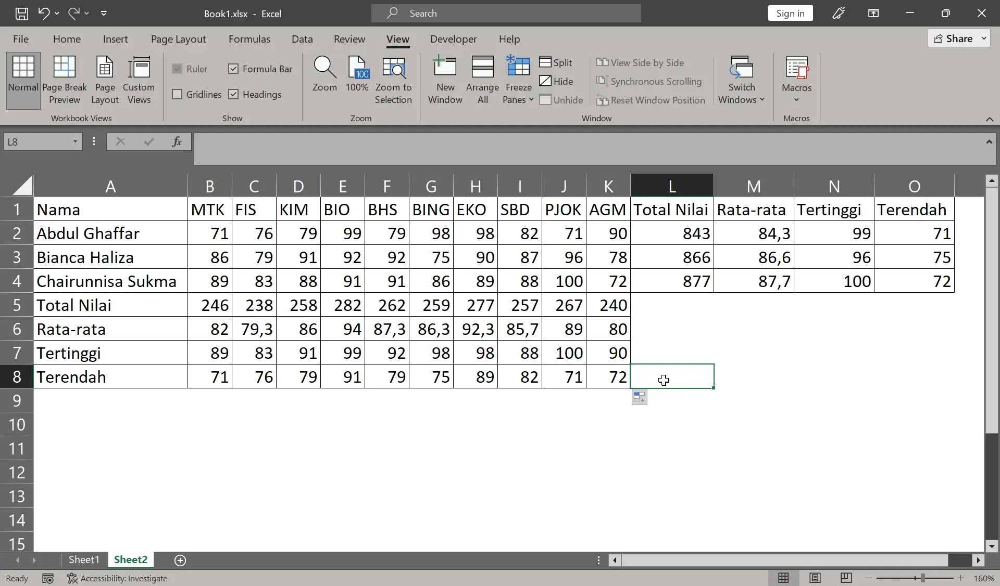

#+title: Menggunakan Fungsi SUM, AVERAGE, MAX, dan MIN di Microsoft Excel
#+date: 2026-10-29
#+hugo_base_dir: ../../../../
#+hugo_section: tutorials/excel
#+hugo_bundle: sum-average-max-min
#+export_file_name: index
# #+hugo_weight: 2
#+hugo_series: "Rumus Excel"
#+hugo_custom_front_matter: :series_order 2

* Pembuka

Pada artikel ini kita akan menggunakan fungsi untuk mengolah banyak data sekaligus. Kita akan menghitung jumlah, mencari rata-rata, serta menentukan nilai terbesar dan nilai terkecil dari sekumpulan angka.

* Pentingnya Fungsi

Sebelumnya di operasi dasar matematika kita hanya menghitung dua angka. Namun sekarang kita akan menghitung lebih banyak angka lagi. Kalau hanya dua angka, kita bisa hitung langsung dengan klik satu per satu sel yang mau dihitung, namun bila angka yang mau dihitung ada 10, 20, atau 100, cara itu pasti melelahkan.

Pada situasi seperti itulah fungsi akan sangat membantu: ia dapat mengolah angka dalam rentang sel, bukan lagi satu per satu.

Fungsi sederhana biasanya cukup ditulis seperti ini:

#+begin_example
=NAMAFUNGSI(rentang)
#+end_example

Karena fungsi adalah rumus, maka dia wajib diawali dengan tanda sama dengan (~=~). Kemudian diikuti dengan nama fungsi tersebut. Setelahnya buka kurung dan masukkan rentang nilai yang mau diolah, lalu tutup kurung.

Untuk fungsi yang lebih kompleks, notasi fungsinya akan menyesuaikan sesuai syarat penggunaan fungsi tersebut.

* Konsep Rentang Sel (/Range/)

Rentang sel, atau disebut juga /range/, adalah kumpulan dari dua sel atau lebih yang berurutan pada lembar kerja Excel. Dia dapat berbentuk deretan satu baris atau satu kolom, atau gabungan dari keduanya yang membentuk satu blok sel.

Rentang sel ini adalah cara menandakan bagian mana pada sel di Excel yang ingin diolah. Agar lebih jelas gambarannya, cobalah buat tabel berikut di Excel:

#+caption: Tabel tanpa rumus

Tabel di atas punya data yang lebih banyak daripada tabel pada artikel sebelumnya. Namun di sini kita cuma perlu buat sekali saja ya. Dan pada bab berikutnya kita akan mengisi kolom total, rata-rata, nilai tertinggi dan terendah satu per satu.

Tabel di atas menampilkan daftar nilai siswa untuk sepuluh mata pelajaran. Lihatlah nilai-nilai Abdul Ghaffar, nilainya berada dari sel =B2= sampai =K2=. Itulah yang disebut rentang sel. Kemudian bagaimana cara menulis rentang nilai tersebut di Excel?

Untuk menulis range, kita menggunakan tanda titik dua =:= untuk menyatakan dari mana selnya bermula dan sampai mana selnya berakhir. Notasinya ditulis seperti ini:

#+begin_example
selawal:selakhir
#+end_example

Maka range nilai Abdul akan ditulis seperti ini: =B2:K2=.

* Langkah-langkah Menggunakan Fungsi

Pada bab ini kita akan menggunakan empat fungsi untuk mengolah data pada tabel sebelumnya. Berikut fungsi yang akan kita gunakan:

| Fungsi  | Kegunaan                  |
|---------+---------------------------|
| SUM     | Menjumlahkan angka        |
| AVERAGE | Mencari rata-rata         |
| MAX     | Menentukan nilai terbesar |
| MIN     | Menentukan nilai terkecil |

** Menggunakan Fungsi SUM

Buka kembali tabel nilai-nilai siswa. Kita akan mengisi total nilai Abdul Ghaffar dengan rumus =SUM=.

*Instruksi*:
1. Pada sel =L2=, ketiklah ==SUM(= tanpa spasi.

2. Kemudian blok nilai Abdul dari kolom =MTK= sampai =AGM=.

   Cara bloknya: Klik nilai =MTK= Abdul lalu tahan, kemudian geser kursor sampai nilai =AGM=-nya. Lalu lepas kliknya.

   Sekarang pada sel =L2= akan tampil rumus ==SUM(B2:K2=.

3. Setelah itu tutup kurung, kemudian tekan =Tab= atau =Enter=.

Hasilnya seperti berikut:

#+caption: Hasil SUM nilai Abdul

Total nilai Abdul Ghaffar adalah 843. Pada gambar di atas, kita bisa lihat rumus akhirnya di *Formula Bar* jadi ==SUM(B2:K2)=.

** Menggunakan Fungsi AVERAGE

Kita lanjut mengisi kolom rata-rata nilai Abdul Ghaffar. Caranya mirip dengan rumus sebelumnya.

*Instruksi*:
1. Pada sel =M2=, ketiklah ==AVERAGE(= tanpa spasi.
2. Blok nilai Abdul, sehingga pada sel =M2= akan tampil rumus ==AVERAGE(B2:K2=.
3. Setelah itu tutup kurung, kemudian tekan =Tab= atau =Enter=.

Hasilnya akan jadi seperti ini:

#+caption: Hasil AVERAGE nilai Abdul

Nilai rata-rata Abdul Ghaffar adalah 84,3. Di *Formula Bar* dapat kita lihat rumusnya adalah ==AVERAGE(B2:K2)=.

** Percobaan Mandiri Fungsi MAX dan MIN

Sekarang tersisa dua kolom: tertinggi dan terendah. Untuk mengisinya coba gunakan cara yang mirip dengan dua rumus sebelumnya.

Kita hanya perlu mengganti fungsi yang digunakan, yaitu =MAX= untuk yang tertinggi dan =MIN= untuk yang terendah.

Hasilnya akan jadi seperti ini:

#+caption: Hasil MAX dan MIN nilai Abdul

Nilai tertinggi Abdul Ghaffar adalah 99 dan nilai terendahnya 71. Pada *Formula Bar*, dua rumus itu akan jadi seperti ini: ==MAX(B2:K2)= pada sel =N2= dan ==MIN(B2:K2)= pada sel =O2=.

Setelah semua rumus di baris pertama terisi, kita gunakan fill handle untuk menyalin rumus ke baris di bawahnya.

Hasilnya jadi seperti ini:

#+caption: Tabel nilai siswa yang sudah terisi semua

** Percobaan Mandiri Mengisi Kolom Data Vertikal

Tadi kita sudah mengisi baris-baris nilai siswa. Sekarang kita akan mengisi kolom-kolom nilai per mata pelajarannya.

Rumus yang digunakan tetap sama, namun sekarang /range/ berubah.

Misalnya kita mau mengisi total nilai untuk mata pelajaran matematika.

1. Pada sel =B5=, ketiklah ==SUM(=.
2. Kemudian blok nilai =MTK= Abdul sampai nilai =MTK= Chairunnisa. Hasilnya jadi ==SUM(B2:B4=.
3. Terakhir tutup kurung, lalu tekan =Enter=.

Hasilnya adalah 246. Pada *Formula Bar* rumusnya akan tampil ==SUM(B2:B4)=.

#+caption: Hasil SUM mapel MTK

Sekarang cobalah untuk mengisi nilai rata-rata, tertinggi, dan terendah untuk mata pelajaran matematika dengan cara yang sama seperti sebelumnya.

Setelah selesai maka hasilnya akan jadi seperti berikut:

#+caption: Hasil total, rata-rata, tertinggi dan terendah mapel matematika

Pada tabel di atas, hasilnya adalah: rata-rata 82, tertinggi 89, dan terendah 71.

Kita bisa cek juga di *Formula Bar*:
- rata-rata =B6=: ==AVERAGE(B2:B4)=,
- tertinggi =B7=: ==MAX(B2:B4)=,
- terendah =B8=: ==MIN(B2:B4)=.

Untuk mengisi kolom mata pelajaran di sebelahnya, gunakan fill handle lalu seret ke samping sampai kolom =AGM=.

Hasilnya akan jadi seperti ini:

#+caption: Tabel terisi penuh

Sekarang kita sudah selesai menghitung semua data siswa dan mata pelajaran pada tabel ini dengan rumus.

* Kesalahan Umum

** Lupa mengetik tanda sama dengan (=)

Semua rumus diawali dengan tanda sama dengan. Tanpa itu Excel akan menganggapnya sebagai teks biasa. Akibatnya Excel tidak melakukan perhitungan apa pun, dan menampilkan teks itu apa adanya.

** Salah mengetik fungsi

Semua fungsi di Excel harus ditulis sama persis sebagaimana seharusnya. Tidak boleh ada salah ketik. Misalnya rumus =SUM=, harus diketik ==SUM(range)=, tidak boleh ==SUMM(range)=. Kalau tidak, dia akan menampilkan pesan error.

** Salah memilih range

Kadang kita bisa kelebihan atau kekurangan memilih range yang mau dihitung. Hal ini tidak menimbulkan pesan error dan tetap menampilkan hasil. Namun hasilnya itu bisa tidak sesuai dengan apa yang kita inginkan.

Untuk memastikan apakah range yang dipilih sudah sesuai, pilih sel yang punya rumus tersebut. Kemudian periksa rumusnya di *Formula Bar*. Agar lebih jelas, coba juga klik rumus yang ada di sana, sehingga sel yang dipilih akan ditampilkan dengan blok warna. Atau kamu juga bisa klik dua kali pada sel yang berisi rumus itu.

** Circular Reference

Ini adalah kelanjutan dari masalah salah memilih range. Kadang kolom hasil tempat rumus diketik juga ikut terpilih sebagai range yang mau dihitung. Di situasi ini Excel akan menampilkan jendela peringatan.
